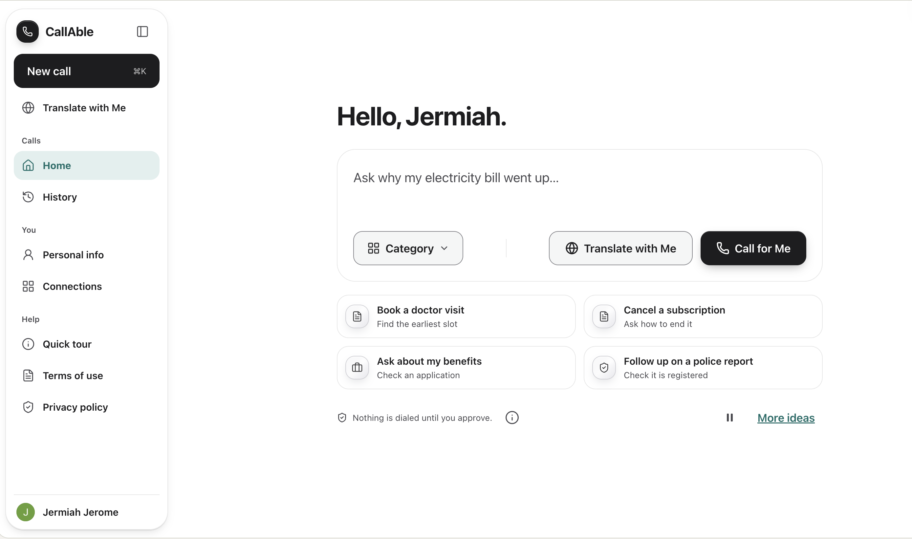
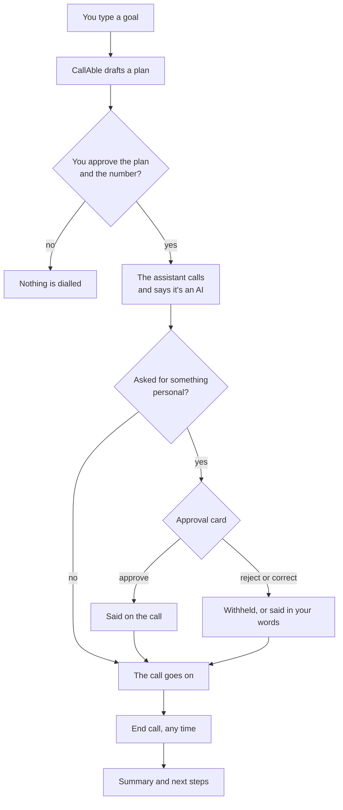
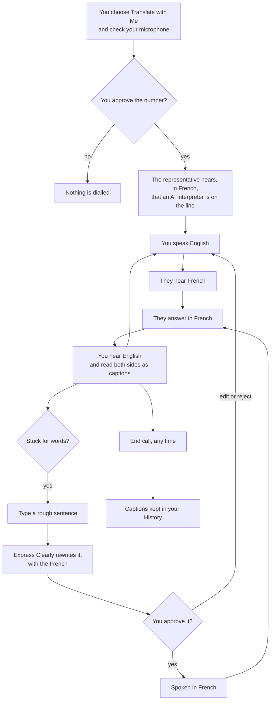
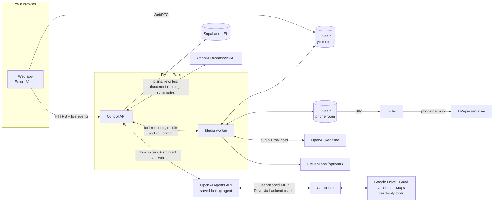
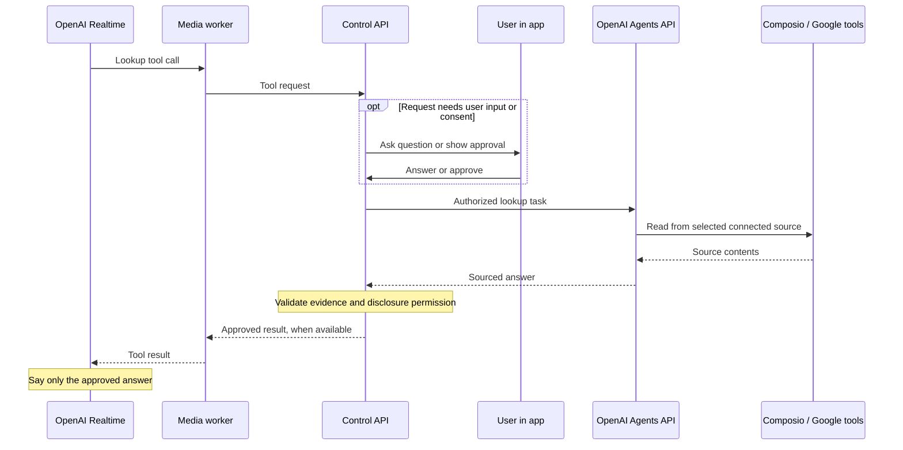
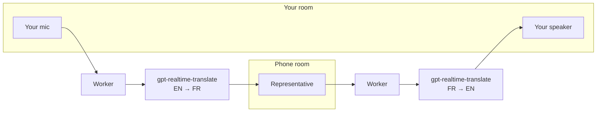
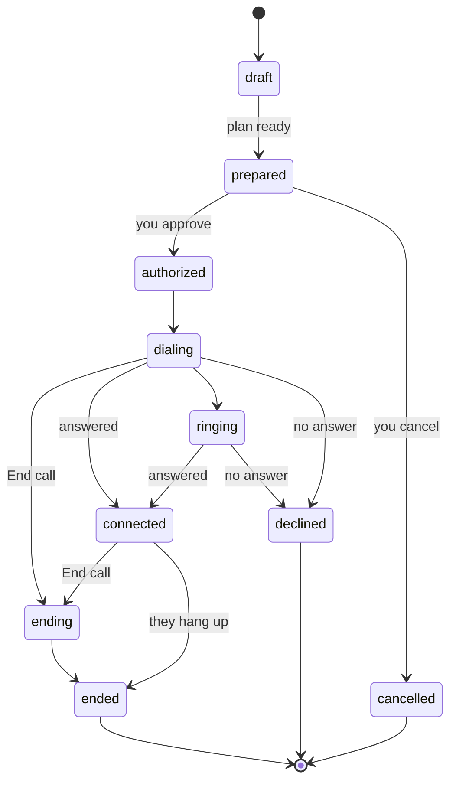
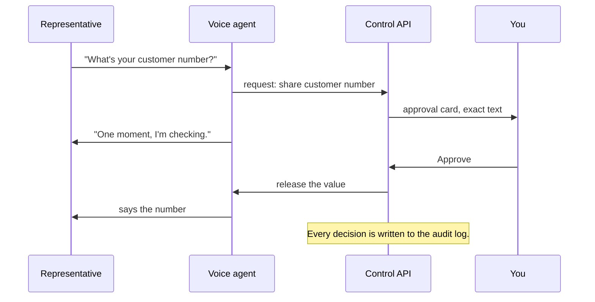
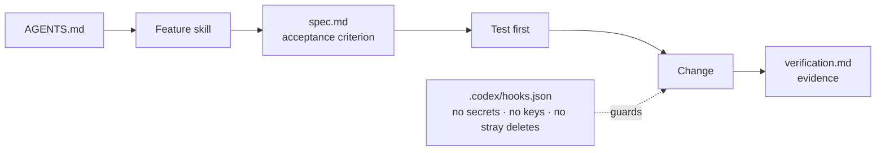

# CallAble

**Your voice, your choice.**

[](https://www.callableai.app) [](https://github.com/jermiah/404-brainnotfound/actions/workflows/ci.yml)  [](https://github.com/jermiah/404-brainnotfound) [](https://github.com/jermiah/404-brainnotfound/blob/main/AGENTS.md)

         

CallAble makes the phone calls you can't, or interprets them live. You approve every step.

> **🥈 Second place** at the DevDay Exchange Community hack, Paris, October 2026. This repo is the showcase. The
> code, specs and full docs live at **[jermiah/404-brainnotfound](https://github.com/jermiah/404-brainnotfound)**,
> and the app at **[callableai.app](https://www.callableai.app)**.

**[Join the waitlist →](https://www.callableai.app)** · Made with ❤️ in Paris by **404 Brain Not Found**: Alex
Beverage, Jermiah Jerome, Sundaravel Selvaraj and Thamimul Ansari, at the DevDay Exchange Community hack, 24–26 October
2026.



**Watch the CallAble demo** · 4 minutes · Click to play and enable sound.

https://github.com/user-attachments/assets/20903223-2918-4a3e-b67b-a3a1c878c754

## Call for Me

> **Surrounded by a violent crowd during a protest in France.** In this scenario, someone is stuck inside a
> restaurant and cannot explain what has happened to the police. They don't know the address or how to share
> their location.

1. They type what has happened and approve the call to the police.
2. CallAble introduces itself as an AI assistant calling with their permission and explains their situation in French.
3. When the officer asks for the exact address, the app asks the user to share their current phone location.
4. With their permission, the app obtains the phone's coordinates. Google Maps resolves those coordinates to a
   street address, which CallAble shares with the officer as the phone's location at the time it was captured.
5. If the officer asks whether they are injured, the user can answer in the app by tapping **Yes** or **No**, or
   typing a reply. CallAble relays their answer without requiring them to speak.



## Translate with Me

> **Jordan doesn't speak French.** His electricity bill has gone up, and he wants to sort it out himself.

1. Jordan speaks English in his browser.
2. The representative hears French on an ordinary phone.
3. Jordan hears the answers in English and reads both sides as captions.
4. Stuck for words, he types a rough sentence. **Express Clearly** makes it clear, and he approves it before it's said.



The representative only ever hears the translation, never Jordan's own voice.

## Always

- Nothing is dialled until you approve.
- You choose, detail by detail, what may be shared. Anything else asks first, and never times out.
- The AI says it's an AI.
- **End call** always works.
- No payments, contracts, passwords or bank details. Ever.
- No call audio is recorded. Your profile and history stay in your browser.
- Not for emergencies: call 112, or contact 114 by text if you can't speak or hear.

Built for keyboard and screen reader, without speaking. Not yet audited for accessibility.

[Terms](https://www.callableai.app/legal/terms.html) · [Privacy](https://www.callableai.app/legal/privacy.html) ·
[CGU](https://www.callableai.app/legal/cgu.html) · [Confidentialité](https://www.callableai.app/legal/confidentialite.html)

## Architecture

### System



Two rooms. The media worker is the only participant in both. The API never touches audio.

### In-call lookup path

Realtime requests a lookup through a tool call. The media worker forwards it to the Control API, which checks
consent and starts the saved agent through the OpenAI Agents API. The agent uses the user's connected Composio
tools. The backend validates the sourced answer and disclosure permission before the worker returns it to
Realtime to say on the call. Realtime does not open an Agents API session or call Composio directly.



Drive lookups pass through the backend's scoped document-reader MCP proxy, which calls Composio and uses the
Responses API to read supported PDFs and images when needed. Gmail, Calendar and Maps lookups use their
source-specific Composio MCP connection. For current location, the app supplies user-authorized device coordinates;
Maps resolves them to an address. Pending lookups return a status while the call waits for consent or a result.

### Translate audio path



Only translated audio crosses rooms. One translation session per direction.

### Call lifecycle



The API owns call state. One transition table. Any state can fail; nothing redials on its own.

### Approval gate



The model asks. Code decides. You approve.

### Models

| Job | Model |
|---|---|
| Call for Me voice | `gpt-realtime-2.1`, voice *marin* |
| Hearing the representative | `gpt-realtime-whisper` |
| Live interpreting | `gpt-realtime-translate` |
| Express Clearly rewrite | `gpt-5.4`, Responses API |
| Plan, invoice reading, summary | `gpt-5-mini`, Responses API |
| Lookups in Gmail, Drive, Calendar, Maps | Saved agent, OpenAI Agents API |

Amounts and dates are formatted by code, never by a model.

### Spec-driven development with Codex



We built feature by feature, using specs to coordinate our team and multiple coding agents. The team brainstormed
with ChatGPT and Codex, defined the architecture, then split implementation into workstreams: call control and
approvals, telephony and media, AI sessions, and the frontend.

[AGENTS.md](https://github.com/jermiah/404-brainnotfound/blob/main/AGENTS.md) was the shared starting point for Codex and Claude Code. It gives each agent the same
product context, document precedence, feature routing and verification rules. When we spun up coding agents for
separate workstreams, they followed that shared map and the matching [feature skill](https://github.com/jermiah/404-brainnotfound/tree/main/.agents/skills). The coding
tools launch the agents; `AGENTS.md` tells them how to work together and where their task belongs.

The development contract runs from the [constitution](CONSTITUTION.md), through the
[product requirements](https://github.com/jermiah/404-brainnotfound/blob/main/callable-docs/CallAble_PRD_v1.md) and
[technical architecture](https://github.com/jermiah/404-brainnotfound/blob/main/callable-docs/CallAble_Technical_Architecture_v1.md), to the individual feature spec.
[DECISIONS.md](https://github.com/jermiah/404-brainnotfound/blob/main/DECISIONS.md) records changes to scope and shared contracts; [ROADMAP.md](https://github.com/jermiah/404-brainnotfound/blob/main/ROADMAP.md) tracks
what is ready to build and what is actually verified.

Each of the eleven [feature folders](https://github.com/jermiah/404-brainnotfound/blob/main/specs/README.md) keeps its development record together:

| File | Purpose |
|---|---|
| `spec.md` | Intended behavior, acceptance criteria, boundaries and failure cases |
| `plan.md` | Implementation approach, dependencies and experiments |
| `tasks.md` | Small, ordered implementation steps tied to acceptance criteria |
| `verification.md` | Checks actually run, their results, evidence and remaining limitations |

For example, [F05 Call for Me](https://github.com/jermiah/404-brainnotfound/blob/main/specs/F05-call-for-me/spec.md),
[F06 Translate with Me](https://github.com/jermiah/404-brainnotfound/blob/main/specs/F06-translate-with-me/spec.md) and
[F07 Context Intake](https://github.com/jermiah/404-brainnotfound/blob/main/specs/F07-context-intake/spec.md) each have their own spec, plan, tasks and evidence.
Agents work from an acceptance criterion, test the behavior, make a small change, and record what the check proved.
Simulated checks stay labelled simulated. Work follows the gates: media proof → Call for Me → translation →
context and safety → demo polish, with independent dashboard work alongside them.

Shared skills and guard hooks live in [`.agents/`](https://github.com/jermiah/404-brainnotfound/tree/main/.agents). This gave the coding agents a consistent workflow
for permissions, secrets and verification across the repository, while the team reviewed and integrated their work.

## Status

A private, invitation-only prototype built in a weekend. English and French only. What's proven on a real call and
what's simulated: [honesty slide](pitch/honesty-slide.md), [ROADMAP.md](https://github.com/jermiah/404-brainnotfound/blob/main/ROADMAP.md).

## Before the pivot

This repo started as Alex's prep for the weekend: a customer-service voice agent that meets the caller at their
level, with OpenAI deciding what to say and [Levelang](https://www.levelang.app) deciding how to say it. At
Saturday's team brainstorm we chose CallAble instead, and the build moved to
[jermiah/404-brainnotfound](https://github.com/jermiah/404-brainnotfound). The prep files are kept in
[`pre-pivot/`](pre-pivot/README.md).

## How we built it

Paris times, from the team's account and the merge log.

**Saturday 24 October**

- 🛒 **Around noon · Discussing the idea at a Monoprix.** The library was closed, so that is where we started.
- **13:00 · Shaping our first idea.** We explored the problem and what CallAble could do.
- **14:00 · The idea was settled; architecture came next.** Our team brainstormed with Codex and ChatGPT,
  working through the call flow, permissions and the tools described above to derive the architecture.
- ☕ **At La Felicità at Station F, we started building**, in public from the first commit.
- 17:53 · Baseline: constitution, specs, call controller, approval gate.
- 18:25 · Voice spike: `gpt-realtime-2.1` asked before agreeing on 16 of 16 test calls.
- 🚪 **19:00 · Evicted from La Felicità.** We carried on remotely for the evening.
- 19:58 · **First real phone call**, through LiveKit and Twilio.
- 20:22 · The Expo app, and calls saved to Supabase.
- 23:26 · Call for Me's voice agent, its tools behind the approval gate.

**Sunday 25 October**

- 01:04 · API and media worker live on Fly.io in Paris. Personal workspace and history.
- 02:12 · **Translate with Me**: two OpenAI translation sessions per call.
- 02:55 · Google connections through Composio.
- 🏠 **Day two at Station F's Flatmates**, all the way through the night.
- 12:13 · Express Clearly, then the post-call summary.
- 13:44 · Two demo stories take shape: an electricity-bill conversation and a police assistance scenario.
- 18:13 · Live at [www.callableai.app](https://www.callableai.app).
- 19:22 · First real Gmail lookup, on a fictional demo inbox.
- **Through the afternoon and evening · Testing Agents API orchestration through Composio.** We worked through
  Google Drive document retrieval, Gmail questions, Google Maps address resolution from user-approved phone
  coordinates, and Calendar lookups for appointments and booking details. We tested the request, tool result,
  approval and answer paths, and investigated failures using the session traces. Calendar access remained read-only.
- 20:29 · The Ink and Glass look.
- 22:01 · The assistant can ask you a question in the app mid-call.
- 23:07 · A landing page with a scripted demo call.
- 23:59 · Terms and privacy policy, in English and French.

**What stood out: OpenAI's Agents API.** Having a managed agent runtime was a huge help over a two-day build.
OpenAI manages the agent sessions, orchestration, context compaction and recovery. We could focus on connecting
tools and building the approval flow without building and operating our own agent execution service. That made
the infrastructure side of growing the agent workload much simpler. Our application still runs its own control
API, media worker and permission checks. See the [Agents API overview](https://developers.openai.com/api/docs/guides/agents-api/overview).

**Monday 26 October**

- 18:00 · Finale at Hexa.
- 🥈 **Second place.**

## Run it

Clone [jermiah/404-brainnotfound](https://github.com/jermiah/404-brainnotfound), then:

```sh
npm install
npm run dev
```

Node.js 24+. Add `?simulate` to the URL for a scripted call: no keys, no phone calls. Live setup:
[docs/DEVELOPMENT.md](https://github.com/jermiah/404-brainnotfound/blob/main/docs/DEVELOPMENT.md).

## Contribute

Issues and pull requests go to [jermiah/404-brainnotfound](https://github.com/jermiah/404-brainnotfound).

[AGENTS.md](https://github.com/jermiah/404-brainnotfound/blob/main/AGENTS.md) · [CONSTITUTION.md](CONSTITUTION.md) · [specs](https://github.com/jermiah/404-brainnotfound/blob/main/specs/README.md) · [DECISIONS.md](https://github.com/jermiah/404-brainnotfound/blob/main/DECISIONS.md) ·
[docs/DEVELOPMENT.md](https://github.com/jermiah/404-brainnotfound/blob/main/docs/DEVELOPMENT.md)

No open-source licence yet: all rights reserved.
