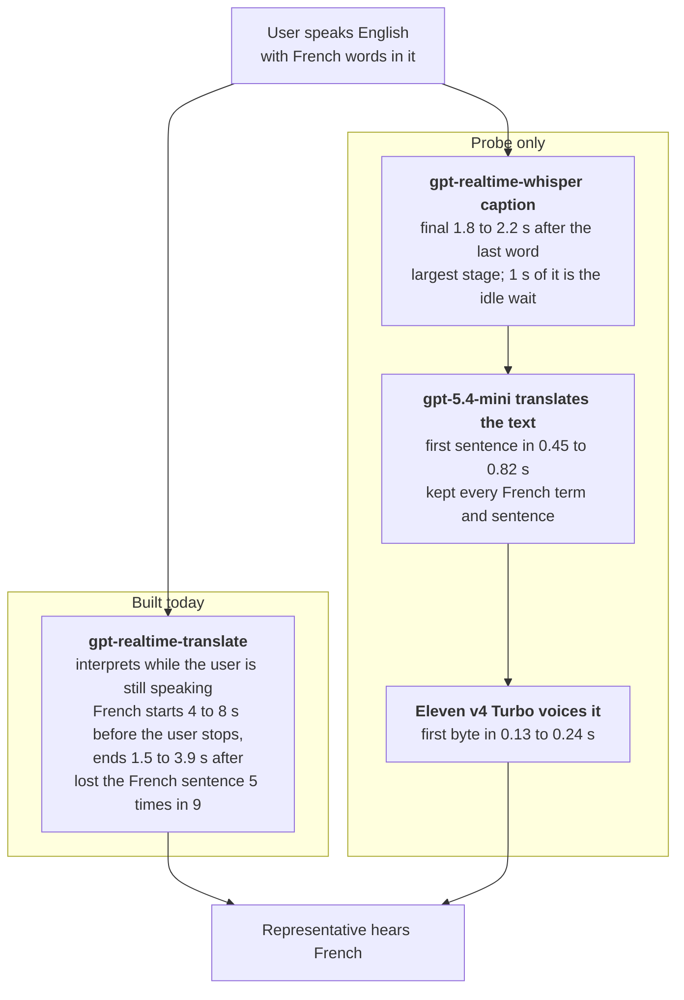

# Voice findings: code-switching and the translation cascade

*Copied from [jermiah/404-brainnotfound](https://github.com/jermiah/404-brainnotfound/blob/main/docs/voice-code-switching-findings.md) on 27 October 2026. The original is the source of truth.*

25 October 2026 · Alex Beverage

Keep `gpt-realtime-translate` for Monday's finale, with safeguards. It is the only path under the 1.5 s latency
target, but it garbles or drops French that an English-speaking user says. A text cascade fixes that, at 1.7 to 2.7 s.

## At a glance

Every OpenAI model held up when French speech carried English words. `gpt-realtime-translate` failed when English
speech carried French. All runs were simulated: synthetic voices, three runs per cell, no phone line.

| Model | Tested on | Result |
| --- | --- | --- |
| `gpt-realtime-whisper` | Captioning French speech with English jargon | 106 of 108 English terms kept. "PR" kept every time, where Scribe Realtime wrote "PIAR" and Gradium lost it |
| `gpt-realtime-whisper` | Captioning English speech with French words | « facture » 9/9, « prélèvements » 9/9, « compte » 6/9. The company spelled right once in 9. « Enfin » heard as "Alpha" 2 times in 9 |
| `gpt-realtime-2.1` (Call for Me) | Replying to a representative who speaks Franglais | French 12 times in 12, with or without a French hint |
| `gpt-realtime-translate` | French to English | English jargon kept, 44 of 45 meaning points |
| `gpt-realtime-translate` | English with French words, to French | « facture » became « fracture » 2 times in 9, « compte » lost 3 times. The company never right; « Salut » every time |
| `gpt-realtime-translate` | A French sentence inside English, to French | The sentence reached the output 4 times in 9. Once « août » became « décembre » |
| Caption cascade (`gpt-5.4-mini`) | The same English-to-French lines | Changed no word the caption held. Every French term and sentence kept. First French audio 1.66 s after the user stops, at best |
| Eleven v4 Turbo | Voicing text | First byte 0.17 s median, as in D-028. `gpt-4o-mini-tts` 0.53 s |

## Two ways to translate

Realtime speaks while the user talks; the cascade waits for the caption. Stage times were measured with the VPN off.

Realtime starts speaking French before the user finishes. The cascade starts only once the caption is final, but it
carries the user's French intact. It reuses the caption the translation session already makes, so it adds no
transcription step.

## Latency

The fastest cascade starts French 1.66 s after the user stops, over the 1.5 s target (AC-F06-10: median under 1.5 s,
from the end of speech to the first translated audio). VPN off, 6 runs and 2 prompts per cascade row
([evidence](https://github.com/jermiah/404-brainnotfound/blob/main/specs/F06-translate-with-me/evidence/cascade-2026-10-25T11-53-20-438Z.json)).

| Path | First French audio, median | Fastest to slowest | Samples |
| --- | --- | --- | --- |
| `gpt-realtime-translate` | 6.5 s *before* the user stops | 7.3 to 4.1 s before | 6 |
| Cascade, Eleven v4 Turbo, ending at the last caption update | **1.66 s** | 1.48 to 1.87 s | 12 |
| Cascade, `gpt-4o-mini-tts`, ending at the last caption update | 1.99 s | 1.82 to 2.21 s | 12 |
| Cascade, Eleven v4 Turbo, after the caption final | 2.66 s | 2.48 to 2.87 s | 12 |
| Cascade, `gpt-4o-mini-tts`, after the caption final | 2.99 s | 2.82 to 3.21 s | 12 |

Realtime starts while the user is still talking; every cascade variant starts after they stop. The fastest ends its
turn at the caption's last update instead of waiting the adapter's 1 s idle, and still misses the target by about
0.16 s. With the VPN on, the medians barely moved, but one slow voice start pushed the worst case to 4.03 s.

## English-to-French accuracy

The cascade kept every French word and sentence the caption held. `gpt-realtime-translate` lost or changed them in most
runs. Lines: "Hi, I'm calling about my facture from Lucioles Énergie. I can see two prélèvements on my compte this
month…" and "I'd like to know why my September bill is higher. Enfin, pourquoi la facture de septembre est plus élevée
que celle d'août ?"

| Measure | `gpt-realtime-translate`, 9 runs | Cascade, 6 runs per prompt |
| --- | --- | --- |
| « facture », « compte », « prélèvements » kept | 21/27 | 18/18 |
| Lucioles Énergie right | 0/9 | 1/6, as the caption spelled it |
| The French sentence reaches the French output | 4/9 | 6/6 |
| Words changed or added | 8 times (below) | none |
| Greeting toward the representative | « Salut » 9/9 | « Bonjour » 6/6, with *vous* |
| English left in the French output | none | none |

What `gpt-realtime-translate` changed:

- « facture » → « fracture », twice; once with an invented cause, « due à un excès d'énergie de Lucille »
- « compte » → « relevé » twice, and → « facture » once (« prélèvements directs sur ma facture »)
- « deux prélèvements » → « deux montants sur mon compte bancaire »
- « ma facture » → « ma facture d'électricité », a word added
- « août » → « décembre »: a changed date, against constitution 3.2

The cascade's two prompts scored the same: naming Lucioles Énergie in the prompt did not fix the name, because the rule
"keep names as written" won. The cascade also repeats caption mistakes: when the caption heard « Enfin » as "Alpha",
the French said « Alpha, pourquoi… ».

## Options

Four ways forward for English to French. Only A and D are buildable before Monday.

| Option | First French audio | Accuracy on French the user says | Pros | Cons | Ready for Monday |
| --- | --- | --- | --- | --- | --- |
| A. Keep `gpt-realtime-translate` | Starts while the user speaks, done 1.5 to 3.9 s after | Low | Only option under the 1.5 s target. One provider, built and conformance-tested. French to English is solid | Garbles and drops French, changed a date once, informal, mangles names. Nothing checks its output, and an English-speaking user cannot catch French errors | Yes |
| B. Cascade for English to French | 1.66 s at best, 2.66 s with today's 1 s caption idle, then the whole sentence | High | Faithful, formal, keeps French. The text step can be instructed and checked in code (constitution 3.4) | Misses 1.5 s. Consecutive, so each turn feels several seconds longer. Three services a turn. Repeats caption mistakes. A new path: DECISIONS row and conformance tests | No |
| C. Hybrid: the cascade only when the caption holds French | As A, plus a late correction | Medium | Keeps realtime speed for plain English. Fixes the dropped French sentence | By the time the caption shows French, realtime has spoken for 4 to 8 s: the representative may hear both versions. Needs French detection. Most complex, untested | No |
| D. A plus safeguards | As A | Low in free speech, high for the facts that matter | Cheap, no change to the voice path: coach plain English, send amounts, dates and references as approved text voiced by Eleven v4 Turbo (D-028), and flag dates or amounts that differ between the two captions | Hides the weakness: a user who mixes in French still gets mangled output | Partly: coaching is free; the approved-text path and the caption check need confirming or building |

## Recommendation

Choose A plus D for the finale, and record B as the measured alternative. The team decides; any change of path needs a
DECISIONS row.

Before Monday's finale:

- [ ] Keep `gpt-realtime-translate` for Translate with Me as built
- [ ] Script the demo user in plain English, with no French words
- [ ] Send exact facts (amounts, dates, references) as approved text voiced by Eleven v4 Turbo
- [ ] If time allows, flag dates and amounts that differ between the source and translated captions, which would have
  caught « août » → « décembre »
- [ ] Re-render the translation disclosure clip with Eleven v4 Turbo, as D-028 intends
- [ ] Leave Call for Me as it is: `gpt-realtime-2.1` with automatic language held up

After the hackathon:

- [ ] Record the cascade's numbers in DECISIONS as the alternative for English to French
- [ ] Revisit the hybrid only if real users mix English and French
- [ ] Test a representative who switches to English by speaking it, which so far was only tried with injected text

## Limits and open questions

These are probe results, not call results. Treat the English-to-French failures as a strong warning, not a final rate.

- **Voices:** one synthetic customer (`gpt-4o-mini-tts` told to give French words an English accent) and a Gradium
  clone for the reference clip. No real learner, no real representative.
- **Sample:** three runs per cell; results moved between renders (« fracture » appeared in one probe only).
- **No phone line:** frames went straight to the adapters. Real 8 kHz phone audio may make accented French harder
  still.
- **Judging:** `whisper-1` decided only which language each output was in; the captions are the record of the words.
- **Cascade timing:** stages ran one after another and were summed, as in the D-028 spike; the voice's first byte for
  the whole text stands for the first sentence's.
- **Network:** the first cascade run left through a VPN.AC exit in the Netherlands, which also caused every ElevenLabs
  403. The VPN-off re-run is the one to quote.
- **Untested:** a representative who switches to English by speaking; whether the deployed worker on Fly reaches
  ElevenLabs.

How to run the probes again: a person runs them with the team key and `env -i`, so the OpenAI key exported in a shell
does not win. The guard-secrets hook stops agents loading the env file, which contradicts AGENTS.md; that is with
Jermiah. Keep any VPN off for ElevenLabs and for latency runs.

## Sources

- [PR #28: code-switching and cascade probes, with results](https://github.com/jermiah/404-brainnotfound/pull/28)
- [F05 verification](https://github.com/jermiah/404-brainnotfound/blob/main/specs/F05-call-for-me/verification.md): Franglais-speaking representative, and its
  [evidence](https://github.com/jermiah/404-brainnotfound/blob/main/specs/F05-call-for-me/evidence/codeswitch-2026-10-25T10-59-56-665Z.json)
- [F06 verification](https://github.com/jermiah/404-brainnotfound/blob/main/specs/F06-translate-with-me/verification.md): code-switching, cascade and the VPN-off re-run
- F06 evidence: [code-switching](https://github.com/jermiah/404-brainnotfound/blob/main/specs/F06-translate-with-me/evidence/codeswitch-2026-10-25T10-59-56-665Z.json),
  [cascade with the VPN on](https://github.com/jermiah/404-brainnotfound/blob/main/specs/F06-translate-with-me/evidence/cascade-2026-10-25T11-39-14-311Z.json),
  [cascade with the VPN off](https://github.com/jermiah/404-brainnotfound/blob/main/specs/F06-translate-with-me/evidence/cascade-2026-10-25T11-53-20-438Z.json)
- [The probe script](https://github.com/jermiah/404-brainnotfound/blob/main/apps/media-worker/scripts/codeswitch-probe.ts)
- Earlier spikes: [Scribe and Gradium on the Franglais clip](https://github.com/jermiah/404-brainnotfound/blob/main/voice/stt-spike/README.md),
  [D-028 realtime and TTS spike](https://github.com/jermiah/404-brainnotfound/blob/main/voice/realtime-spike/README.md)
